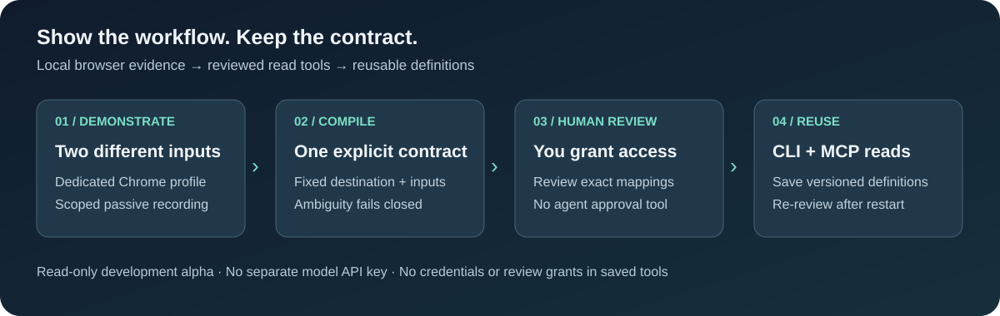

English · [فارسی](docs/i18n/README.fa.md) · [العربية](docs/i18n/README.ar.md) · [Español](docs/i18n/README.es.md) · [简体中文](docs/i18n/README.zh-CN.md)

<p align="center">
  
</p>

<p align="center">
  <a href="#-copy-this-setup-prompt-to-your-coding-agent">Agent setup prompt</a> ·
  <a href="#quick-start">Quick start</a> ·
  <a href="#how-it-works">How it works</a> ·
  <a href="#built-vs-planned">Built vs. planned</a> ·
  <a href="#safety-model">Safety model</a> ·
  <a href="#roadmap">Roadmap</a>
</p>

<p align="center">
  
  
  
  
</p>

## 🎬 Show a workflow. Keep a reusable tool.

**Demonstrate an authorized browser read twice. Compile its inputs into an inspectable contract. Review it yourself. Call it from your agent.**

Show2Tool is a local TypeScript CLI and MCP authoring server. The development alpha connects scoped browser recording, candidate compilation, human-reviewed JSON reads, and versioned saved definitions. Your existing coding agent supplies the reasoning—there is no embedded model loop or separate model API key.

<p align="center">
  
</p>

| | What you get today |
| :---: | :--- |
| 🧭 | **Scoped recording** in a dedicated Chrome profile; login happens before capture. |
| 🧩 | **Input inference** for a single request, scalar query/body bindings and explicit ID-safe path templates. |
| 🔐 | **Human-reviewed reads** with fixed destinations, scoped cookies and bounded JSON output. |
| 🛠️ | **CLI + MCP authoring** from shared command schemas and runtime handlers. |
| 💾 | **Saved tools and read chains** that survive restart; permissions never do. |
| 🔗 | **Bounded read composition** with projected-result dependencies and digest-bound verification. |
| 📚 | **Explicit cursor pagination** with page, result and output limits. |
| 🧪 | **Synthetic integration tests** covering capture, execution, review boundaries and recovery. |

> [!IMPORTANT]
> **Development alpha—not production automation.** External-account compatibility is not established. Start with synthetic data or an authorized sandbox. The new runtime executes GET reads only; write probes live separately in `spike/`. No npm release or portable workflow export is available. Named reviewed-workflow MCP execution is available locally; it still depends on the running human-authorized host.

## 🤖 Copy this setup prompt to your coding agent

Copy the entire block below into your agent. It installs from source, checks the checkout, and leaves browser authorization to you.

```text
Set up Show2Tool from https://github.com/MahdiHabibiXr/show2tool.

1. Check for Node.js 24+, npm, Git and Google Chrome. Report missing
   prerequisites; do not change system settings or install global tools.
2. Clone the repository into a new show2tool directory. If it already exists,
   inspect it first; do not overwrite files, discard changes or reset branches.
3. Read package.json, README.md, docs/AGENT-USAGE.md and
   skills/show2tool/SKILL.md before running project commands.
4. Run npm ci --ignore-scripts, npm run typecheck, npm test, and
   npm run demo. Report actual results and any environment limitations.
5. Run npm run agent -- commands and npm run agent -- schema to discover
   supported interfaces. Use absolute executable paths outside the checkout.
6. Ask which authorized sandbox and read-only task I want to demonstrate.
   Help draft a narrow scope file; never guess permission for a real account.
7. Ask ME to start the host in an interactive terminal, authorize the scope,
   and log in manually. Never type or pipe human authorization/review phrases,
   copy cookies, use my daily browser profile, or perform write actions.
8. Guide two different demonstrations, compile the broker-owned recordings,
   save the complete successful result, and ask me to review it in the host.
   After restart, I can use saved and load <tool-id> to review it again.

Do not publish, push, configure an MCP client, or claim semantic verification
without my permission and independent expected results. No extra model API
key is needed. Explain unsupported workflows instead of bypassing safeguards.
```

**Want the shortest path first?** Run the synthetic demo below. For a complete hands-on local authoring exercise, follow [the read-only sandbox walkthrough](docs/SANDBOX.md). For browser authoring and MCP setup, follow [the agent usage guide](docs/AGENT-USAGE.md). Translated READMEs currently describe the earlier feasibility milestone; this English guide reflects the read-tool alpha.

## Quick start

**Requirements:** Node.js 24+, npm, and Google Chrome in a standard installation location. Local validation is on Windows; CI is configured for Windows and Linux, but platform success must be established by actual runs. Use `npm run agent -- doctor` after building for prerequisite diagnostics.

```sh
git clone https://github.com/MahdiHabibiXr/show2tool.git
cd show2tool
npm ci --ignore-scripts
npm run demo
```

The demo opens an isolated temporary **headless** Chrome profile, demonstrates two searches, and checks a third. It does not access your normal Chrome profile or require a model API key.

### What a successful run shows

```json
{
  "status": "passed",
  "scope": "synthetic fixture only",
  "trainingInputs": ["alpha", "beta"],
  "heldOutInput": "gamma",
  "resultIds": ["a3"],
  "writes": 0,
  "captureRows": 2
}
```

*Selected fields from the demo output. Timing, byte counts and contract hashes are run-specific. This is not a performance benchmark.*

### Keep and inspect the evidence

```sh
# Choose a directory that does not exist yet.
npm run demo -- --out my-new-evidence

# Group captured endpoints without returning approved scalar values.
npm run cli -- inspect my-new-evidence/recording.json

# Inspect the parameter mapping learned from annotated demonstrations.
npm run cli -- infer my-new-evidence/demonstrations.json
```

Saved artifacts contain synthetic recordings, annotated demonstrations and a result report—not an executable tool export. Existing evidence is never overwritten.

## 🧑‍💻 Example: a reusable catalog search

Suppose your authorized sandbox exposes `GET /api/catalog/search?term=...`. Demonstrate searches for two different terms, then compile the selected request from each recording. The candidate binds your `searchText` input to `term`; it does not execute the request during compilation.

**Start the human host** after preparing a narrow scope file:

```text
npm run build
node dist/src/cli.js host scope.json
```

**Ask the agent to record** one demonstration at a time using command files:

```json
{"command":"record_start","inputs":{"searchText":"first query"}}
```

Demonstrate the search yourself, then send `{"command":"record_stop"}`. Repeat with a different query. Use `schema` to discover the full `compile_recordings` specification and select the returned recording/request IDs.

**Save compiler output and review it** in the human host console:

```text
review path/to/candidate.json
```

The console displays the exact contract and requires `review <tool-id>`. Successful scoped review also saves the definition locally. The agent can now call:

```json
{"command":"run","id":"find_catalog","inputs":{"searchText":"unseen query"}}
```

The ID must match your compiled specification. Check independently expected facts with `verify`—HTTP success alone is not semantic verification:

```json
{"command":"verify","id":"find_catalog","inputs":{"searchText":"unseen query"},"expected":{"/items/0/id":"book_3","/items/length":1}}
```

Use facts from an independent source, not the response you just received. Check `data.status` (`passed` or `failed`), not only `ok`. The host saves a digest-bound report without raw inputs, expected values or response values. This checks a named case; it does not prove an input was unseen or certify the tool generally. See [verification details](docs/AGENT-USAGE.md#verify-independently-expected-results).

**Come back tomorrow without recording again:**

```text
saved
load find_catalog
```

These are human-console commands. Loading displays the saved contract and requires fresh review; it never restores an old permission. For multiple versions, use `load <tool-id> <digest>`.

### 🔌 Connect an MCP client

After building, configure your client to launch the local authoring server. Replace the executable path with your checkout's absolute path:

```json
{
  "mcpServers": {
    "show2tool": {
      "command": "node",
      "args": ["/absolute/path/show2tool/dist/src/cli.js", "serve", "--stdio"]
    }
  }
}
```

This exposes `show2tool_*` authoring tools. Start the human host separately for recording and execution. MCP cannot authorize scope or approve a workflow. See [the full setup and safety guide](docs/AGENT-USAGE.md) for scope examples, Windows quoting and current limits.

## How it works

```text
  Two demonstrations           Local processing              Held-out check
 ┌───────────────────┐       ┌────────────────────┐       ┌──────────────────┐
 │ Search for alpha  │       │ Scope API traffic  │       │ Search for gamma │
 │ Search for beta   │ ────▶ │ Infer q → query    │ ────▶ │ Expect record a3 │
 └───────────────────┘       │ Freeze contract    │       │ Check effects    │
                             └────────────────────┘       └──────────────────┘
```

1. **Observe, don't replay.** Selected-main-frame CDP capture records the demonstrated requests without issuing extra writes.
2. **Keep evidence small.** Schema-first summaries are the default. Scalar query/body values require an explicit allowlist.
3. **Reject ambiguity.** Multiple matching inputs or unchanged examples do not count as a generalized binding.
4. **Test a new input.** The fixture's independently seeded data supplies the expected result.
5. **Treat writes separately.** A write needs an expiring one-use intent bound to the destination, tenant and exact proposed change.

HTTP 200 and a valid JSON shape are not enough: the tests also check the selected records, tenant, update version and actual effects.

## Built vs. planned

| Capability | Current status |
| :--- | :--- |
| Isolated Chrome + CDP capture | **Implemented and exercised locally** |
| Main-frame scope, duration and retention limits | **Implemented**, with explicit incomplete markers |
| Two-demo query and scalar create-field inference | **Implemented for synthetic fixtures** |
| Unseen-input replay and search → detail dependency | **Implemented for synthetic fixtures** |
| Destination-bound create/update intents and read-back | **Implemented and tested**, injected approval adapter |
| Post-commit process death → unknown outcome, no resend | **Tested with an independent effects counter** |
| Compact `inspect` and annotated-demo `infer` commands | **Implemented** |
| Human terminal confirmation | Helper available; **live human exercise pending** |
| General website workflow compiler | **Planned** |
| Portable executable CLI/MCP export | **Planned** |
| Local read-session broker and authoring skill | **Implemented for the development alpha** |
| Human-reviewed CLI/MCP GET runtime | **Implemented**, shared command handlers |
| Versioned saved definitions + fresh review after restart | **Implemented**, no persisted execution grants |
| Typed named MCP tools and saved read chains | **Implemented**, current reviews and digest pins required |
| ID-safe path inputs and bounded cursor pagination | **Implemented**, explicit human scope |
| Scalar verification for individual reads and chains | **Implemented**, independent expectations required |
| Clean production install and CLI/MCP smoke | **Exercised locally**, hosted CI evidence pending |
| Durable write-confirmation broker | **Planned** |

## Safety model

### Local by default

- No hosted service, embedded model loop or separate AI API key.
- The synthetic demo uses a temporary profile; the alpha host uses a dedicated persistent profile containing sensitive login state. Neither copies your daily Chrome profile.
- Spike replay is restricted to registered synthetic origins. The alpha read runtime instead enforces the human-reviewed origin/path/field scope and destination policy.
- Saved definitions contain manifests only, not cookies, recordings or execution grants. Approved literal values can still be sensitive; keep the local catalog private.

### Explicit effects

- Recording does not replay demonstrated writes.
- A write intent expires and is consumed once; destination and tenant must match.
- Versioned updates and read-back check what actually happened.
- A lost acknowledgment or interrupted dispatch becomes **unknown**, never an automatic retry.
- No automatic rollback: a compensating action would be a separate write.

### Honest boundaries

These are accident-prevention checks, **not OS isolation against an unrestricted same-user process**. CDP may buffer data before application checks; retention limits are not a hard cap on all Chrome memory or network ingestion. Key filtering cannot identify every secret or personal field.

Payments, deletion, permission changes, bulk operations, real-account automation and external sending/publication are outside the current prototype.

## Try the human-confirmation probe

Run in an actual interactive terminal:

```sh
npm run probe:manual
```

It shows the destination, tenant and exact synthetic create action. Type the requested `approve <intent-id>` phrase to create **one temporary test task**, or anything else to deny. Noninteractive input is refused before the fixture starts.

Automated approval-adapter tests do not substitute for a live human run. That feasibility check remains open.

## Development

```sh
npm run typecheck
npm test
```

Tests cover browser scope, ambiguous mappings, tenant/auth failures, semantic mismatches, bounded pagination, approval reuse, gzip expansion, JSON depth, stalled responses, and actual child-process termination around dispatch.

> [!NOTE]
> An intermittent concurrent-dispatch test failure has been observed and is not yet root-caused. Passing runs are evidence for those runs, not a production-readiness guarantee.

<details>
<summary><strong>Repository map</strong></summary>

```text
spike/
  capture.ts         Scoped CDP observations and retention limits
  infer.ts           Candidate bindings and ambiguity detection
  replay.ts          Fixture-only transport and read workflows
  intents.ts         Destination-bound mutation intents
  journal.ts         Durable dispatch state and recovery
  approve.ts         Local confirmation adapter
  inspect.ts         Compact recording summaries
  cli.ts             Inspect / infer command entry point
  demo.ts            Runnable synthetic read pipeline
  manual.ts          Interactive synthetic write probe
  fixture/           Local application and independent effects state
test/
  spike/             Unit, integration and browser probes
  helpers/           Real-process crash workers
assets/
  banner.svg         Repository banner
```

</details>

## How this differs from CLI-Anything

[CLI-Anything](https://github.com/HKUDS/CLI-Anything) builds agent-friendly command-line interfaces from software codebases or existing APIs. Show2Tool starts from **demonstrated browser/API traffic** and investigates parameter generalization, explicit write confirmation and independent result checks.

The projects overlap in making software usable by agents. They are not the same implementation, and Show2Tool does not bundle CLI-Anything. This distinction is a product hypothesis, not a claim that other projects lack verification.

## Roadmap

- [x] Synthetic browser capture → inference → unseen-input replay
- [x] Captured create demonstrations → approved synthetic write → read-back
- [x] Compact evidence inspection and crash-outcome probes
- [ ] Finish feasibility gates: live human confirmation and competitor execution
- [x] Single-request reviewed read contract and CLI/MCP runtime
- [x] Local read-session broker and versioned saved definitions
- [x] ID-safe path parameters, bounded cursor pagination and reusable verified read chains
- [ ] Automatically compile multi-step demonstrations
- [ ] Add durable cross-process write approval
- [ ] Export inspectable CLI and MCP packages from the same runtime
- [ ] Package the authoring skill and test it in a fresh agent session
- [ ] Publish compatibility results and reproducible benchmarks

## Contributing

Focused reproductions are useful: an ambiguous input mapping, a missing omission marker, an incorrect outcome, or a privacy regression. Use synthetic data and report the command, environment, expected result and actual result. Never attach cookies, browser profiles or raw account traffic.

There is **no open-source license selected yet**. Source visibility is not a grant of redistribution rights. Licensing and public-release packaging remain open decisions.
