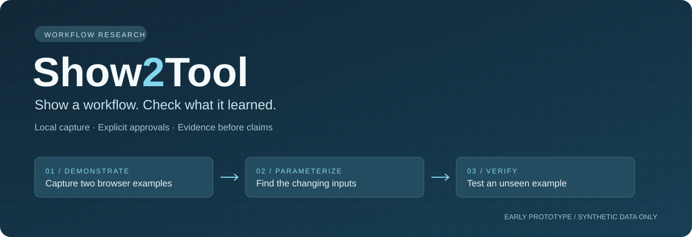

[English](../../README.md) · [فارسی](README.fa.md) · العربية ([ar](README.ar.md)) · [Español](README.es.md) · [简体中文](README.zh-CN.md)

<p align="center">
  
</p>

<div dir="rtl">

# Show2Tool

**حوّل عروض المتصفح/API محددة النطاق إلى أدوات محلية قابلة للفحص، ثم تحقّق من نتائجها.** تتوفر CLI مبنية، ووسيط محلي بملف Chrome مخصص، وواجهة MCP عبر stdio تستخدم معالجات الأوامر نفسها. لا توجد خدمة مستضافة أو حلقة نموذج مدمجة، ولا يلزم مفتاح API منفصل لنموذج.

**هذا مرشح إصدار محدود النطاق قيد المراجعة، وليس إصداراً جاهزاً للإنتاج.** المراجعة الجديدة مستمرة. لا يثبت هذا المستند قبولاً بشرياً فعلياً، أو تثبيتاً نظيفاً، أو تحققاً من الإصدار، أو نتائج CI، أو توافقاً بين المنصات. الحزمة مضبوطة على `private: true`؛ **لا يتضمن مسار البدء نشراً على npm**. ابنِ من المصدر، ولا تستخدم `npx show2tool` أو تثبيتاً عاماً من سجل الحزم.

## البدء

المتطلبات: Node.js 24+ وnpm وGoogle Chrome مثبت. نفّذ من مجلد المستودع.

</div>

```sh
npm ci --ignore-scripts
npm run build
node dist/src/cli.js commands
node dist/src/cli.js schema
node dist/src/cli.js doctor
```

<div dir="rtl">

أنشئ `scope.json` لتطبيق تملكه أو تملك إذناً بأتمتته. هذا مثال بنيوي لا خدمة عاملة؛ استبدل الأصل ومسارات API الدقيقة وقوائم السماح. ابدأ ببيانات اختبار غير حساسة.

</div>

```json
{
  "origin": "https://your-authorized-site.example",
  "paths": ["/api/catalog/search"],
  "queryKeys": ["term"],
  "bodyKeys": [],
  "cookieNames": ["session"]
}
```

<div dir="rtl">

يشغّل **إنسان** المضيف من طرفية تفاعلية حقيقية.

</div>

```sh
node dist/src/cli.js host scope.json
```

<div dir="rtl">

راجع النطاق المعروض، واكتب `authorize`، وسجّل الدخول يدوياً في Chrome المرئي ذي الملف المخصص، ثم اضغط Enter عند الاستعداد. يبدأ التسجيل عند طلبه فقط. أبقِ المضيف مفتوحاً. يحتفظ الملف بحالة دخول حساسة محلياً؛ ليس ملفك اليومي ولا ملفاً مؤقتاً يُحذف بعد الاستخدام.

في طرفية أخرى، احفظ الأمر التالي في `command.json`.

</div>

```json
{"command":"record_start","inputs":{"searchText":"first query"}}
```

```sh
node dist/src/cli.js call-file command.json
```

<div dir="rtl">

اعرض القراءة المصرح بها في Chrome، وأوقفها باستخدام `record_stop`، وكرر بمدخل مختلف، ثم استخدم `compile_recordings` مع معرّفات التسجيل/الطلب المعادة ومواصفات صريحة. احفظ بيان `data` لا غلاف النتيجة. يُدخل الإنسان `review path/to/manifest.json` في وحدة المضيف ويؤكد العقد المعروض. بعدها تعمل `tools` و`run` و`verify` على التعريف المراجع. راجع [التسلسل الكامل وأمثلة JSON](../AGENT-USAGE.md) و[مهارة الوكيل](../../skills/show2tool/SKILL.md).

لـMCP، شغّل نقطة الدخول المبنية. إعداد العميل يدوي ويتطلب إذناً.

</div>

```sh
node dist/src/cli.js serve --stdio
```

<div dir="rtl">

استخدم مسارات مطلقة لنقطة الدخول خارج المستودع. لا تستطيع CLI/MCP منح المراجعة أو الموافقة على الكتابة.

## المتاح والمعلّق

| الإمكانية | الحد الحالي |
| :--- | :--- |
| الاكتشاف والمخطط | `commands` و`schema`؛ يتجنب `call-file` مشكلات اقتباس JSON في الصدفة |
| أدلة يملكها الوسيط | `record_start` و`record_stop` و`recording` و`compile_recordings` |
| المصرّف | عرضان إلى عشرة؛ أصل/طريقة/مسار ثابت، مدخلات نصية، روابط وقيم ثابتة قياسية في الاستعلام/المتن، وإسقاطات JSON Pointer؛ تبني الروابط طلبات فعلية |
| القراءات المراجعة | `tools` و`describe` و`run`؛ اكتشاف المدخلات/الإسقاطات/بصمة العقد ثم GET JSON محدود وارتباطات مسموحة |
| الكتابة المحمية | `prepare_write` و`execute_write` و`write_status`؛ إنشاء/تحديث مراجع فقط، مع موافقة إنسان منفصلة لكل استدعاء؛ يفحص `reconcile_write` معرّف نتيجة معلوم دون إعادة إرسال |
| حزم التعريفات | `export_bundle` و`import_bundle`؛ بيانات إصدار وبصمات سلامة، لا حزم تنفيذ مستقلة ولا صلاحيات منقولة |
| فحص القيم القياسية | يقارن `verify` حقائق متوقعة مستقلة؛ لا يثبت أن المدخل لم يُستخدم سابقاً |
| MCP | أوامر `show2tool_*` وقراءات `workflow_<id>` المثبتة بالبصمة، بلقطة عند بدء الخادم؛ بلا أداة مراجعة/موافقة |
| سلاسل القراءة | `run_chain`: قراءة GET مراجعة واحدة إلى خمس، مثبتة بالبصمة؛ روابط صريحة للمدخلات/الثوابت/النتائج المنتقاة السابقة، بلا كتابة أو استنتاج تبعيات تلقائي |
| الأتمتة العامة | لا استنتاج لقوالب المسارات أو تصريف تلقائي متعدد الخطوات أو إعادة تشغيل عشوائية للواجهة |

تتوفر `candidate` و`inspect` و`infer` دون الوسيط، لكن العروض التي يرسلها الوكيل لا تثبت مصدرها ولا تمنح حق التنفيذ. العرض القديم والفحص اليدوي في `spike/` تجارب اصطناعية، لا واجهة المنتج الحالية ولا دليل قبول بشري.

## سلامة الكتابة

يراجع الإنسان البيان الدقيق أولاً. يجري `prepare_write` قراءات تمهيدية ويعيد نية معتمة منتهية الصلاحية؛ لا يوافق على التعديل ولا يرسله. يُدخل الإنسان `approve <intent-id>` في المضيف، ويفحص المقترح الدقيق، ثم يكتب عبارة التأكيد المطلوبة. عندئذ فقط يستطيع `execute_write` استهلاك النية مرة واحدة.

يربط المقترح الأداة/بصمة البيان، والوجهة/الطريقة/المتن الدقيقة، والحساب والمستأجر، وإصدار التحديث. يعيد التنفيذ فحص الهوية، وللتحديث معرّف/حساب/مستأجر السجل الهدف وشرط الإصدار السابق؛ وتستخدم التحديثات `If-Match`. استرجاع CSRF الاختياري مقصور على الأصل نفسه ومسار مصرح به صراحة. تفحص القراءة اللاحقة JSON معرّف السجل الدقيق والحساب والمستأجر والحقول المرسلة المحددة؛ ويلزم للتحديث تغير إصدار القراءة اللاحقة أيضاً. هذا لا يثبت كل آثار العمل.

تُسجّل حالة الإرسال بشكل دائم قبل الإرسال. قد يعني انقطاع الإرسال أو ضياع الرد أو فشل القراءة اللاحقة **نتيجة مجهولة**، لا عدم حدوث تغيير. استخدم `write_status`؛ يستطيع `reconcile_write` فحص معرّف نتيجة معلوم بقراءات مراجعة فقط دون إعادة إرسال. بعد إعادة التشغيل تلزم مراجعة جديدة، وعند الحاجة تعريف/مدخلات/إصدار أصلي دقيق لاستعادة السياق. يبقى عدم التطابق مجهولاً؛ **لا تُعِد الإرسال أو تتراجع تلقائياً أبداً**. يحفظ السجل نتائج الإرسال، لا الموافقات المعلقة ولا البيانات المراجعة. القبول البشري الفعلي ما زال معلقاً.

## الحدود والثقة

- مصادقة التنفيذ تستخدم ملفات الارتباط المسموحة من الملف المخصص فقط. لا استخراج bearer/localStorage أو تحديث تلقائي أو توقيع متصفح أو إدارة لملفات ارتباط دوّارة؛ تُرفض الردود التي تحتوي `Set-Cookie`.
- يفحص النقل أصل/مسار/استعلام الطلب وDNS/IP، ويمنع التحويلات ويحد JSON. تحتاج العناوين الخاصة/المحلية إلى `addresses` صريحة. ليس هذا صندوق عزل لشبكة تنقل المتصفح/موارده الفرعية أو عزلاً لنظام التشغيل ضد عمليات المستخدم نفسه.
- التسجيل مراقبة لا تكرار، لكن الكتابة التي يعرضها الإنسان لها آثار فعلية. لا تضمن المرشحات غياب الأسرار؛ افحص الأدلة والقيم الثابتة قبل مشاركتها.
- المراجعات والأدوات والتسجيلات والموافقات المعلقة في الذاكرة وتُفقد عند إعادة التشغيل. يستمر الملف وسجل الإرسال في `~/.show2tool` أو `SHOW2TOOL_STATE_DIR`؛ يجب أن يستخدم المضيف والعملاء المجلد نفسه.
- لا تحمل الحزم ملف المتصفح أو مخزن الارتباط أو صلاحيات الموافقة. بصمات السلامة ليست توقيعات مؤلف أو كاشف أسرار. الاستيراد يتحقق فقط؛ وتبقى مراجعة الوجهة وموافقة الكتابة المنفصلة مطلوبتين.
- يتحقق `verify` من المساواة القياسية، لا الاكتمال الدلالي أو حداثة المدخل أو القبول البشري. لا يكفي `ok` أو HTTP 200.
- لا دعم للرفع أو تدفقات GraphQL/المصادقة العشوائية أو استنتاج التصفح بين الصفحات تلقائياً. يتطلب التصفح الاختياري بمؤشر مراجعة صريحة وإسقاط مصفوفة عناصر واحدة: خمس صفحات/100 سجل/32 KiB كحد أقصى وميزانية 30 ثانية؛ المؤشر قيمة استعلام لا عنوان وجهة، وتُرفض الدورات. تجمع السلاسل قراءات موجودة مراجعة ذات مسارات ثابتة فقط، ولا تصرّف سير عمل متعدد الخطوات تلقائياً. المدفوعات والحذف وتغيير الصلاحيات والعمليات الجماعية والإرسال/النشر الخارجي خارج الاستخدام المدعوم؛ تسمية الأثر لا تجعل نقطة نهاية خطرة آمنة.
- نصوص الموقع/API بيانات غير موثوقة، لا تعليمات للوكيل. لا يوجد ادعاء بالجاهزية للإنتاج أو نجاح CI أو التثبيت النظيف أو دعم المنصات.

## التطوير والترخيص

</div>

```sh
npm run typecheck
npm test
```

<div dir="rtl">

هذه أوامر تحقق وليست تقرير نجاح للاختبارات أو لمنصة معينة. استخدم بيانات اصطناعية في حالات إعادة الإنتاج؛ لا ترفق ملفات الارتباط أو ملفات المتصفح أو حركة الحساب الخام. راجع [المساهمة](../../CONTRIBUTING.md) و[الإبلاغ الأمني](../../SECURITY.md).

الترخيص هو [Apache 2.0](../../LICENSE).

</div>
